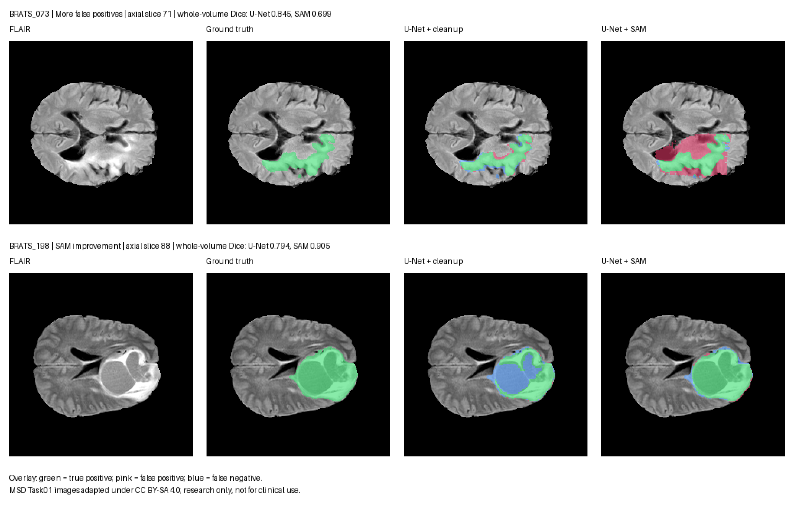

# FLAIR whole-tumour segmentation: U-Net and SAM

Research-only experiment on [Medical Segmentation Decathlon](https://medicaldecathlon.com/) Task01 BrainTumour. A single-channel 2D U-Net predicts whole tumour (all nonzero label classes) from FLAIR MRI. Its connected components generate bounded box prompts for frozen [Segment Anything](https://github.com/facebookresearch/segment-anything) ViT-B. The locked held-out comparison includes a simple FLAIR threshold, raw U-Net, U-Net with the same candidate cleanup, and U-Net plus SAM. SAM is retained in the report even if it makes the result worse. This is **not for clinical use**.

The earlier course team contributed the initial concept of applying SAM to brain-tumour segmentation. This repository uses a new implementation and public MSD data; it contains none of that team's code, data, checkpoints, images, or unverified metrics. Team member names can be added with their consent.

## Data and licence

MSD lists its data under [CC BY-SA 4.0](https://creativecommons.org/licenses/by-sa/4.0/) and asks users to cite the challenge. Cite: Antonelli et al., *The Medical Segmentation Decathlon*, Nature Communications 13, 4128 (2022), https://doi.org/10.1038/s41467-022-30695-9. The 484 labelled training cases support this study; the separate 266 unlabelled test cases do not. The pipeline asserts the FLAIR channel and tumour label definitions in `dataset.json` before use. [MONAI publishes](https://github.com/Project-MONAI/MONAI/blob/dev/monai/apps/datasets.py) the archive URL and MD5 `240a19d752f0d9e9101544901065d872`.

SAM citation: Kirillov et al., *Segment Anything*, ICCV (2023), [official code and model](https://github.com/facebookresearch/segment-anything).

## Setup and reproduction

The commands below run from the repository root on Python 3.11. Keep data and model checkpoints outside Git. The working directory examples put the dataset beside the repository.

```bash
python3.11 -m venv .venv
.venv/bin/python -m pip install -r requirements.lock.txt
.venv/bin/python -m pip install --no-deps .
df -h .
mkdir -p ../brain-tumor-data
curl -L --fail --continue-at - -o ../brain-tumor-data/Task01_BrainTumour.tar https://msd-for-monai.s3-us-west-2.amazonaws.com/Task01_BrainTumour.tar
.venv/bin/python scripts/prepare_data.py --archive ../brain-tumor-data/Task01_BrainTumour.tar --out ../brain-tumor-data --delete-archive
.venv/bin/python -m pytest -q
.venv/bin/python -m brain_tumor.train --data ../brain-tumor-data/Task01_BrainTumour --smoke --output artifacts/smoke.pt
.venv/bin/python -m brain_tumor.train --data ../brain-tumor-data/Task01_BrainTumour
curl -L --fail -o artifacts/sam_vit_b_01ec64.pth https://dl.fbaipublicfiles.com/segment_anything/sam_vit_b_01ec64.pth
.venv/bin/python scripts/benchmark_sam.py --data ../brain-tumor-data/Task01_BrainTumour
.venv/bin/python -m brain_tumor.evaluate tune --data ../brain-tumor-data/Task01_BrainTumour
.venv/bin/python -m brain_tumor.evaluate test --data ../brain-tumor-data/Task01_BrainTumour --export-dir artifacts/predictions
.venv/bin/python scripts/verify_outputs.py --data ../brain-tumor-data/Task01_BrainTumour
.venv/bin/python scripts/write_results.py
```

The split is fixed in `splits/patients.json`. Training includes every axial training slice, including empty slices. Validation patients select the checkpoint, thresholds, connected-component size, and box padding. Test labels are loaded only by the final `test` command for metrics. Inference functions use no labels. The output masks restore source shape and affine. `artifacts/` and NIfTI files are ignored by Git.

## Predict one unlabelled volume

After training, run the locked U-Net on a 3D FLAIR NIfTI volume. For Task01's 4D images, select its verified FLAIR channel explicitly:

```bash
.venv/bin/python -m brain_tumor.predict \
  --input ../brain-tumor-data/Task01_BrainTumour/imagesTs/BRATS_557.nii.gz \
  --flair-channel 0 \
  --output-dir artifacts/demo_557
```

Add `--sam-checkpoint artifacts/sam_vit_b_01ec64.pth` to produce the SAM refinement too. The command reads no label or manifest, writes `unet.nii.gz`, `unet_cleaned.nii.gz`, optionally `unet_sam.nii.gz`, and a `run.json` record with hashes and timings. These masks retain the input volume's spatial shape and affine. The trained checkpoint is not published in Git; train it with the reproduction commands above. Load only checkpoints from sources you trust.

## What the masks look like



`BRATS_073` shows SAM adding false-positive tissue; `BRATS_198` shows SAM recovering tumour missed by the U-Net. The titles give **whole-volume** Dice, while the pictures show single slices chosen retrospectively for illustration. Green is true positive, pink false positive, and blue false negative. The boxes that prompt SAM come only from connected components of the U-Net candidate mask. See the [exploratory failure analysis](docs/failure_analysis.md) for patient-level relationships and [figure attribution](docs/figures/ATTRIBUTION.md) for the MSD CC BY-SA 4.0 source and adaptation notice. Rebuild the figure with:

```bash
.venv/bin/python scripts/render_case_study.py --data ../brain-tumor-data/Task01_BrainTumour
```

See [plan](docs/plan.md) and [results](docs/results.md) for recorded execution status and findings. Proposed portfolio extensions are in the [extension roadmap](docs/extension-plan.md).

The complete 72-patient held-out comparison found mean whole-volume Dice of 0.7931 for the U-Net and 0.7566 for U-Net plus frozen SAM. SAM increased mean tumour recall from 0.7768 to 0.8113 and mean false-positive volume from 12.85 to 31.85 mL. See `docs/results.md` for every patient and `metrics/results.json` for machine-readable values.
