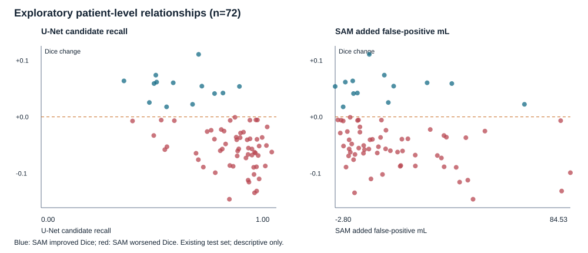

# Exploratory failure analysis

This retrospective analysis uses the already inspected 72-patient test set. It does not select a new method or establish a fresh held-out result. Ground truth is used only to measure coverage and error, never to make prompts.

Locked results SHA-256: `81571ea0d6675da89b112646e2808eb53663e20fcebc806a671e9b1eb5dd8e05`. Split SHA-256: `f47ad61669a733ca531e89ade8499483cc739bedcdf9355e302caf170826697b`. Selection SHA-256: `5f3654174d83ab286d63135bb5f01a16d47e09b2868c8c348168fe4b01a73e8a`.

## Associations with SAM minus cleaned U-Net Dice

Spearman correlations across patients are descriptive. P values are exploratory and unadjusted; these relationships are not causal.

| Patient measure | Spearman rho | Exploratory p |
|---|---:|---:|
| Tumour volume (mL) | +0.167 | 0.16 |
| U-Net candidate tumour recall | -0.474 | 2.55e-05 |
| U-Net box tumour coverage | -0.360 | 0.00191 |
| Tumour slices without a prompt | +0.185 | 0.12 |
| SAM added false-positive volume (mL) | -0.287 | 0.0146 |

## Counts and examples

Patients with at least one tumour-bearing slice without a U-Net prompt: 72/72.
Median unprompted tumour-bearing slices per patient: 10; median fraction of tumour voxels on those slices: 1.380%.
Patients where SAM added false-positive volume: 68/72; median added volume +13.04 mL.
Median candidate recall was 0.830, and median box coverage was 0.933. Patients with higher candidate recall tended to have a more negative SAM Dice change (rho -0.474); this is a descriptive association, not a causal finding.

- `BRATS_073`: Dice change -0.1459; added false positives +48.41 mL; candidate recall 0.800; box coverage 0.939; tumour slices without a prompt 9.
- `BRATS_198`: Dice change +0.1108; added false positives +9.87 mL; candidate recall 0.670; box coverage 0.950; tumour slices without a prompt 7.

## Interpretation limits

Candidate coverage and box coverage are related by construction, and added false positives are mathematically related to Dice. Associations can explain where the observed errors occur but cannot prove a mechanism. The input is FLAIR-only, one dataset split, and a frozen natural-image SAM model.

Machine-readable patient values: `metrics/failure_analysis.json`.
